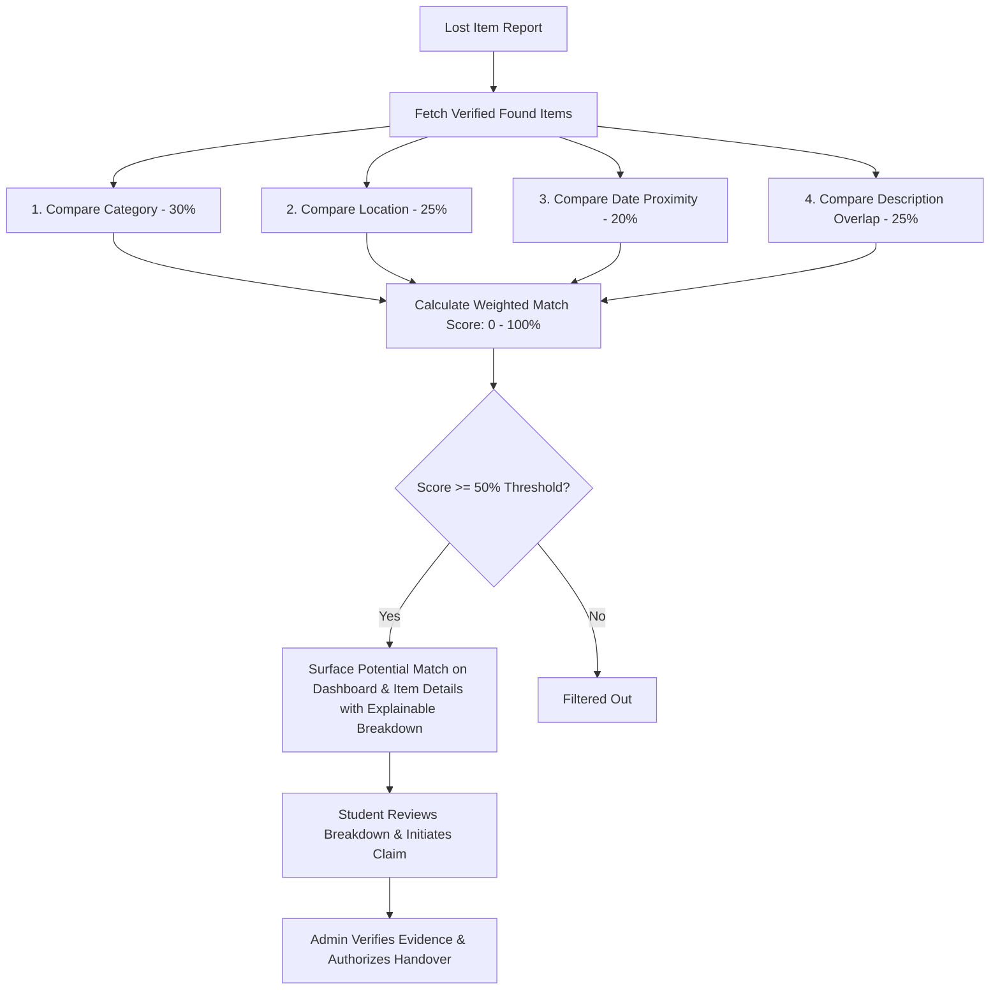
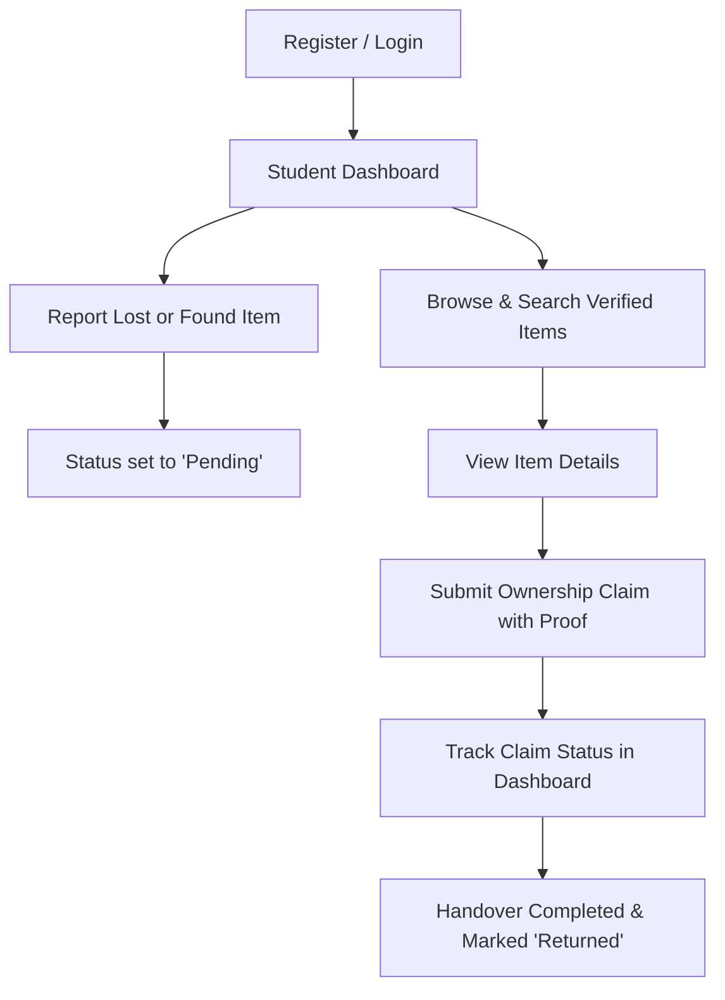
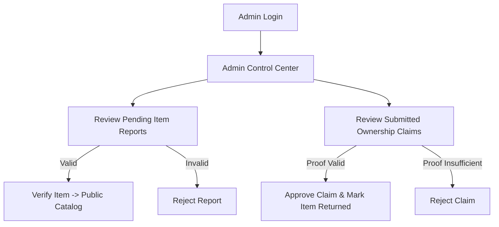

# Smart Lost & Found Portal for Campus

[](https://www.python.org/)
[](https://flask.palletsprojects.com/)
[](https://www.sqlite.org/)
[](LICENSE)

A centralized, secure web application designed for university campuses to streamline the reporting, cataloging, administrative verification, and ownership claiming of lost and found personal belongings.

---

## 📌 Problem Statement

On university and college campuses, thousands of personal items (such as student identity cards, laptop chargers, scientific calculators, notebooks, keys, and personal accessories) are misplaced daily across lecture halls, computer laboratories, libraries, cafeterias, and sports complexes. 

Without a centralized and structured system:
- Misplaced items are scattered across multiple disparate physical desks (department security, reception, library desks).
- Students have no transparent means to check if their lost belonging has been discovered.
- Honest finders have no clear protocol to deposit or report found belongings.
- There is a high risk of fraudulent claims and unauthorized retrieval due to lack of administrative validation and proof checking.

---

## 🎯 Objectives

1. **Centralized Platform**: Provide a single campus-wide portal accessible to all enrolled students, faculty, and administrative staff.
2. **Transparent Lifecycle**: Enable real-time tracking of item statuses (`Pending` $\rightarrow$ `Verified` $\rightarrow$ `Returned` or `Rejected`).
3. **Fraud Prevention**: Mandate administrative review and proof-of-ownership messages prior to releasing any item.
4. **Intuitive Discovery**: Offer fast multi-attribute search and category filtering for rapid item location.
5. **Security & Privacy**: Ensure secure session handling, role-based access control (RBAC), password hashing, and SQL injection prevention.

---

## 🚀 Key Features

### 👨‍🎓 Student Features
- **Account Registration & Authentication**: Secure registration with campus email validation and Werkzeug password hashing.
- **Personal Dashboard**: Track all personal reported items, submission dates, admin verification status, and claim updates.
- **Report Belonging**: Submit structured reports for both **Lost** and **Found** items with mandatory campus location, date, category, and descriptive details.
- **Catalog Browsing & Keyword Search**: Search across verified items with dynamic filtering by category, item type (Lost/Found), or keywords.
- **Item Details & Claim Submission**: View full specifications of cataloged items and submit ownership claims with specific proof descriptions.
- **Prevent Self-Claims**: Built-in validation disallowing students from claiming items they reported themselves.

### 🛡️ Administrator Features
- **Protected Admin Dashboard**: Restricted route (`/admin`) guarded with strict RBAC; non-admin users receive `403 Forbidden`.
- **System Metrics Overview**: Live counts of total items, pending verifications, verified items, returned items, and pending claims.
- **Report Moderation**: Verify genuine student reports into the public catalog or reject incomplete/inappropriate submissions.
- **Claim Review & Decision**: Evaluate claimant proof descriptions, with one-click approval and automatic item return tagging.
- **Direct Return Tagging**: Mark items as returned to their owners once handover is finalized.
- **User Directory**: View registered campus accounts, contact emails, and assigned roles.

---

## 🌟 Novelty: Smart Lost–Found Matching

A key innovation in this portal is the **Smart Lost–Found Matching Engine** ([`matching.py`](file:///c:/Users/Kalam/OneDrive/Desktop/SE-Micrporject/matching.py)), which automatically correlates reported lost belongings with newly discovered found items in real-time.

Instead of relying solely on exact keyword searches, the system performs **deterministic, explainable multi-attribute scoring** using calibrated weights:

```
┌────────────────────────────────────────────────────────────────────────┐
│               SMART LOST-FOUND MATCHING ATTRIBUTES                     │
├──────────────────────────┬───────────┬─────────────────────────────────┤
│ Attribute                │ Weight    │ Matching Technique              │
├──────────────────────────┼───────────┼─────────────────────────────────┤
│ 1. Category Similarity   │ 30% (0.30)│ Exact / Hierarchical Match      │
│ 2. Location Similarity   │ 25% (0.25)│ Jaccard Token & Sequence Match  │
│ 3. Date Proximity        │ 20% (0.20)│ Absolute Calendar Distance      │
│ 4. Description Overlap   │ 25% (0.25)│ Keyword Intersection & Sequence │
└──────────────────────────┴───────────┴─────────────────────────────────┘
```

### Explainable Match Calculation Workflow



### Explainable Match Output
For every match meeting the 50% threshold, the user is presented with a clear explanation:
- **Match Score**: e.g., **91.5% Match**
- **Category (30%)**: Exact Match (100%)
- **Location (25%)**: High Location Match (100%)
- **Date Proximity (20%)**: Same Day (100%)
- **Description (25%)**: High Similarity (66.0%)

### Seamless Integration with Claims & Administrative Moderation
Smart Matching **enhances** rather than replaces human moderation:
1. Only **Verified** items are cross-matched.
2. Students can click **"Claim This Item"** directly from the match card to lodge an ownership claim with identifying proof.
3. Campus Administrators retain final adjudication through proof evaluation before marking items `Returned`.

---

## 🛠️ Technology Stack

| Layer | Technology | Details |
|---|---|---|
| **Backend** | Python Flask 3.1.3 | Lightweight, standard WSGI web framework |
| **Security** | Werkzeug Security | Scrypt / PBKDF2 salted password hashing, HTTP sessions |
| **Database** | SQLite3 | ACID-compliant embedded database with foreign key cascades |
| **Frontend** | HTML5, CSS3, Vanilla JavaScript | Responsive grid, glassmorphism UI, accessible forms |
| **Automated Testing** | Pytest 9.1.1 | 25 passing functional, boundary, negative, and security tests |

---

## 💻 System Requirements

- **Operating System**: Windows 10/11, macOS, or Linux
- **Python**: Version 3.10, 3.11, 3.12, 3.13, or 3.14
- **Web Browser**: Google Chrome, Mozilla Firefox, Microsoft Edge, or Safari

---

## ⚙️ Installation & Setup Guide

### 1. Clone the Repository
```bash
git clone https://github.com/kalamhussain-hit/SE-MICROPROJECT.git
cd SE-MICROPROJECT
```

### 2. Install Dependencies
Using the Python launcher (`py` on Windows) or standard `python`:
```bash
py -m pip install -r requirements.txt
# OR
pip install -r requirements.txt
```

### 3. Initialize & Seed the Database
Initialize SQLite database tables and seed realistic sample campus records:
```bash
py database/db.py
# OR
python database/db.py
```
*Expected Output:*
```
Database initialized successfully.
Sample data seeded successfully.
```

---

## 🏃 Running the Application

Start the local Flask development server:
```bash
py app.py
# OR
python app.py
```

Open your browser and navigate to:
```
http://127.0.0.1:5000
```

---

## 🔑 Pre-Configured Demo Credentials

The seeded database comes with pre-configured accounts for testing and academic evaluation:

| Role | Name | Email Address | Password | Permissions |
|---|---|---|---|---|
| **Student** | Rahul Sharma | `rahul@campus.edu` | `Student@123` | Report items, browse catalog, claim items, student dashboard |
| **Student** | Priya Patel | `priya@campus.edu` | `Student@123` | Report items, browse catalog, claim items, student dashboard |
| **Administrator** | Campus Administrator | `admin@campus.edu` | `Admin@123` | Verify/reject reports, approve/reject claims, mark returned |

> **Tip**: On the login page, use the **Quick Demo Login** buttons to automatically populate student or administrator credentials.

---

## 🔄 User Workflows

### Student Workflow


### Administrator Workflow


---

## 📁 Project Structure

```
SE-MICROPROJECT/
├── app.py                     # Main Flask application & route controllers
├── matching.py                # Smart Lost–Found multi-attribute matching engine
├── requirements.txt           # Python package dependencies
├── README.md                  # Comprehensive project documentation
├── LICENSE                    # MIT open-source license
│
├── database/
│   ├── schema.sql             # Relational SQLite database schema DDL with item_matches
│   ├── db.py                  # Connection handlers, table creation & sample data seeding
│   └── lost_found.db          # Active SQLite database file
│
├── templates/                 # Jinja2 HTML5 presentation templates
│   ├── base.html              # Core navigation, flash banners, and footer
│   ├── index.html             # Landing page with hero, search & recent items
│   ├── login.html             # Secure login form with demo credentials filler
│   ├── register.html          # Student registration with validation
│   ├── dashboard.html         # Personal student dashboard with Smart Matches section
│   ├── report.html            # Lost/Found item reporting form
│   ├── items.html             # Filterable catalog with search & status tags
│   ├── item_details.html      # Detailed item specs & potential opposite-type matches
│   ├── claim.html             # Claim submission form with proof guidelines
│   ├── admin.html             # Admin moderation panel with metrics, tabs & match monitor
│   └── error.html             # Custom HTTP 403, 404, 500 error display
│
├── static/                    # Front-end static assets
│   ├── css/
│   │   └── style.css          # Design system, responsive layout, status badges
│   └── js/
│       └── script.js          # Client-side validation, mobile menu, auto-dismiss alerts
│
├── tests/
│   └── test_app.py            # 25 automated pytest tests (positive, negative, security)
│
└── docs/                      # Software Engineering documentation artifacts
    ├── SRS.md                 # IEEE 830-style Software Requirements Specification
    ├── test_cases.md          # 25 detailed test cases with executed actual results
    └── uml/                   # Five GitHub-ready Mermaid UML diagrams
        ├── use_case.md        # Use Case Diagram
        ├── class.md           # Class Diagram
        ├── sequence.md        # Sequence Diagram
        ├── activity.md        # Activity Diagram
        └── state_machine.md   # State Machine Diagram
```

---

## 🧪 Testing Instructions

Run the automated test suite with verbose reporting:
```bash
py -m pytest tests/test_app.py -v
```

*Summary of Test Coverage (25 Passing Tests):*
- **Positive Testing**: Home page rendering, user registration, student & admin login, logout, item reporting, searching, item details view, claim submission, admin verification, claim approval, direct return tagging.
- **Negative Testing**: Duplicate email registration, invalid login credentials, short passwords, password mismatch, empty report forms, empty claim messages, invalid item IDs.
- **Boundary & Security Testing**: SQL injection prevention (`' OR 1=1 --`), role-based unauthorized access rejection (`403 Forbidden` on `/admin`), unauthenticated redirect handling, prohibition of self-claims, prohibition of claiming returned items.

---

## 📜 License

This project is licensed under the MIT License - see the [LICENSE](LICENSE) file for details.
