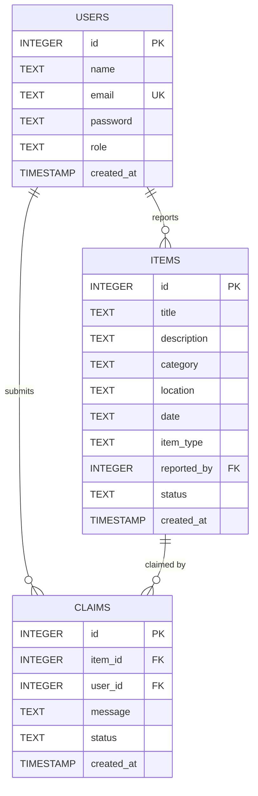

# Software Requirements Specification (SRS)
## Smart Lost & Found Portal for Campus

**Version:** 1.0  
**Date:** October 2026  
**Status:** Approved / Implemented  
**Standard:** IEEE Std 830-1998 Compliant  

---

## 1. Introduction

### 1.1 Purpose
This document provides a comprehensive Software Requirements Specification (SRS) for the **Smart Lost & Found Portal for Campus**. It details both functional and non-functional requirements implemented in the deployed application, defining system behavior, external interfaces, architectural constraints, and traceability for students and campus administrators.

### 1.2 Scope
The Smart Lost & Found Portal is a centralized web application serving university campus stakeholders. It replaces unorganized physical lost-and-found desks with a digital platform where students can catalog lost or found belongings, search campus reports, and lodge verified claims. Campus administrators moderate all submissions, authenticate ownership claims against user-submitted proof, and manage item lifecycle statuses from initial report to verified handover.

### 1.3 Objectives
- Eliminate delays in reuniting students with lost belongings.
- Provide a single, authenticated repository for all campus items.
- Prevent fraudulent claims through administrative moderation and proof verification.
- Provide real-time visibility into the status of reports and claims.
- Guarantee data integrity and security through password hashing, role-based access control, and parameterized queries.

### 1.4 Intended Audience
- **Software Engineers & Developers**: For maintenance, architectural review, and feature enhancements.
- **Academic Evaluators & Instructors**: For assessment against Software Engineering curriculum criteria.
- **Campus Administrators & Security Staff**: For operational understanding of item verification and claim resolution.
- **End Users (Students & Staff)**: As reference for system capabilities and expected operational workflows.

---

## 2. Overall Description

### 2.1 Product Perspective
The Smart Lost & Found Portal is an independent, self-contained web application. It runs on standard university infrastructure or personal workstations using Python Flask, an embedded SQLite database, and semantic HTML5/CSS3/JavaScript frontends. It requires no heavy external cloud services or commercial third-party dependencies.

```mermaid
graph TD
    Client[Web Browser Client] <-->|HTTP / HTML5 / CSS / JS| FlaskApp[Flask Application Server (app.py)]
    FlaskApp <-->|Python SQLite3 API| DB[(SQLite Database: lost_found.db)]
```

### 2.2 User Classes and Characteristics
1. **Student / General Campus User**:
   - Primary user base consisting of enrolled students and faculty.
   - Can register accounts, authenticate, view cataloged items, search by keywords/categories, report lost or discovered items, submit ownership claims with evidence, and monitor claim resolutions from a personal dashboard.
2. **Campus Administrator**:
   - Campus security personnel or student affairs officers.
   - Holds privileged access to the administrative control panel (`/admin`).
   - Responsible for verifying genuine item reports, rejecting fraudulent or duplicate entries, assessing claim proof messages, authorizing item handovers, and auditing user directories.

### 2.3 Operating Environment
- **Operating System**: Platform independent (Windows 10/11, Linux, macOS).
- **Runtime Environment**: Python 3.10+ (specifically validated on Python 3.14).
- **Web Browsers**: Modern standards-compliant browsers (Google Chrome 110+, Mozilla Firefox 110+, Microsoft Edge 110+, Apple Safari 16+).

### 2.4 Design and Implementation Constraints
- **Lightweight Architecture**: Must operate on standard consumer hardware without requiring containerization (Docker) or enterprise database servers.
- **Zero Plaintext Credentials**: All passwords must be cryptographically hashed using salted key derivation algorithms before persistence.
- **Strict Role Separation**: Administrative routes must be strictly protected against unauthorized elevation of privileges.
- **Data Integrity**: Foreign key constraints and transaction cascades must be enforced at the database engine level.

### 2.5 Assumptions and Dependencies
- Users possess valid campus or personal email addresses for registration.
- End users access the portal via web browsers with JavaScript enabled.
- The hosting server environment maintains write permissions to the local `database/` directory for SQLite file storage.

---

## 3. Functional Requirements

| Requirement ID | Module / Feature | Description | Priority |
|---|---|---|---|
| **FR-01** | User Registration | The system shall permit students to register by providing Full Name, unique Email Address, and Password ($\ge 6$ characters). Duplicate emails shall be rejected. | High |
| **FR-02** | User Authentication | The system shall authenticate registered users via email and password, establishing a session containing User ID, Name, Email, and Role. | High |
| **FR-03** | Role-Based Redirection | Upon login, the system shall redirect administrators to `/admin` and students to `/dashboard`. | High |
| **FR-04** | User Logout | The system shall allow authenticated users to terminate their session, clearing all session cookies and redirecting to the login view. | High |
| **FR-05** | Student Dashboard | The system shall present a personal dashboard summarizing reported items, verification statuses, submitted claims, and claim outcomes. | High |
| **FR-06** | Report Lost Item | The system shall permit students to log lost items with Title, Category, Location, Date, and Description ($\ge 10$ characters), setting status to `Pending`. | High |
| **FR-07** | Report Found Item | The system shall permit students to log found items with Title, Category, Location, Date, and Description ($\ge 10$ characters), setting status to `Pending`. | High |
| **FR-08** | Catalog Browsing | The system shall display verified and returned items to general visitors and students, showing type tags, category, location, date, and reporter name. | High |
| **FR-09** | Multi-Criteria Search | The system shall allow users to search items using text keywords across title, description, and location, combined with Category and Item Type filters. | Medium |
| **FR-10** | Item Details View | The system shall provide a dedicated detail page for each item (`/items/<id>`) detailing its full description and metadata. | High |
| **FR-11** | Submit Claim | The system shall allow authenticated students to lodge an ownership claim on a verified item with a detailed proof message ($\ge 10$ characters). | High |
| **FR-12** | Prevent Self-Claiming | The system shall prevent users from submitting ownership claims on items they reported themselves. | High |
| **FR-13** | Admin Dashboard & Metrics | The system shall display total counts of items, pending reports, verified items, returned items, and pending claims to authorized administrators. | High |
| **FR-14** | Admin Report Verification | The system shall permit administrators to verify pending item reports, making them visible in the public campus catalog. | High |
| **FR-15** | Admin Report Rejection | The system shall permit administrators to reject invalid, incomplete, or spam item reports. | High |
| **FR-16** | Admin Claim Review & Return | The system shall allow administrators to approve or reject claims, and mark verified items as `Returned` upon successful handover. | High |

---

## 4. Non-Functional Requirements

### 4.1 NFR-01: Performance
- **Response Latency**: The web application shall render database queries and HTML views within 200 milliseconds under standard campus intranet loads.
- **Resource Footprint**: The backend server process shall operate within under 100 MB of physical RAM.

### 4.2 NFR-02: Security
- **Password Hashing**: Passwords shall never be stored in plaintext; they must be hashed using `werkzeug.security.generate_password_hash` (Scrypt / PBKDF2).
- **SQL Injection Prevention**: All database interactions must use parameterized SQL queries with `?` parameter placeholders.
- **Authorization Guardrails**: Protected admin routes (`/admin`, `/admin/items/*`, `/admin/claims/*`) must enforce `@admin_required` decorators, returning HTTP `403 Forbidden` for non-administrative access attempts.
- **Cross-Site Scripting (XSS)**: All user-generated text inputs must be automatically escaped by the Jinja2 templating engine.

### 4.3 NFR-03: Usability
- **Responsive Layout**: The interface shall automatically adapt to mobile screens ($\le 768\text{px}$) and desktop viewports ($\ge 1024\text{px}$).
- **Status Cues**: Clear, color-coded badges shall indicate item statuses (`Pending` = Amber, `Verified` = Green, `Rejected` = Red, `Returned` = Purple).
- **Error Feedback**: User-facing errors must provide actionable guidance without exposing technical stack traces or database errors.

### 4.4 NFR-04: Reliability & Data Integrity
- **ACID Transactions**: Database transactions must maintain consistency using SQLite foreign key enforcement (`PRAGMA foreign_keys = ON;`).
- **Referential Integrity**: Deletion or updating of user accounts or item records shall cascade cleanly to associated claims.

---

## 5. External Interface Requirements

### 5.1 User Interfaces
- **Home Landing View (`/`)**: Displays hero search bar, system statistics, and recent verified campus belongings.
- **Catalog View (`/items`)**: Filter toolbar (keyword search, category, item type, admin status filter) and responsive cards grid.
- **Reporting View (`/report`)**: Radio selector for Lost vs. Found, category dropdown, date picker bounded to today, location, and description.
- **Item Details View (`/items/<id>`)**: Comprehensive metadata summary, proof guidelines, and dynamic claim button.
- **Claim Submission View (`/claim/<id>`)**: Item recap and ownership proof textarea.
- **Student Dashboard (`/dashboard`)**: Metric cards, personal reported items table, and submitted claims table.
- **Admin Control Center (`/admin`)**: Metric cards, tabbed views for Item Reports, Claims Review, and Registered Users directory.

### 5.2 Software Interfaces
- **Python Standard Library & Flask**: Core WSGI web application framework.
- **SQLite3 Database Engine**: Storage interface via Python `sqlite3` module with `sqlite3.Row` row factory.
- **Werkzeug Security**: Cryptographic password hashing and verification services.

### 5.3 Communication Interfaces
- **HTTP / HTTPS**: Standard web protocols operating on TCP port 5000 (configurable) for browser-server client requests.

---

## 6. Data Requirements & Schema Specifications

The relational schema is defined across three primary tables with enforced foreign-key constraints:



### Table 1: `users`
- `id` (INTEGER, Primary Key, Autoincrement): Unique user identifier.
- `name` (TEXT, NOT NULL): Full name of student or administrator.
- `email` (TEXT, UNIQUE, NOT NULL): Campus email address used as login username.
- `password` (TEXT, NOT NULL): Cryptographically hashed password.
- `role` (TEXT, NOT NULL, DEFAULT `'student'`): User role (`'student'` or `'admin'`).
- `created_at` (TIMESTAMP, DEFAULT CURRENT_TIMESTAMP): Account registration timestamp.

### Table 2: `items`
- `id` (INTEGER, Primary Key, Autoincrement): Unique item identifier.
- `title` (TEXT, NOT NULL): Concise title of the item.
- `description` (TEXT, NOT NULL): Identifying physical features and markings.
- `category` (TEXT, NOT NULL): Categorical classification (e.g., Electronics, Books).
- `location` (TEXT, NOT NULL): Campus building or room where lost/found.
- `date` (TEXT, NOT NULL): Date the item was misplaced or located (YYYY-MM-DD).
- `item_type` (TEXT, NOT NULL, CHECK: `'Lost'` or `'Found'`): Report category.
- `reported_by` (INTEGER, NOT NULL, Foreign Key $\rightarrow$ `users.id`): Reporting user ID.
- `status` (TEXT, NOT NULL, DEFAULT `'Pending'`, CHECK: `'Pending'`, `'Verified'`, `'Rejected'`, `'Returned'`).
- `created_at` (TIMESTAMP, DEFAULT CURRENT_TIMESTAMP): Submission timestamp.

### Table 3: `claims`
- `id` (INTEGER, Primary Key, Autoincrement): Unique claim identifier.
- `item_id` (INTEGER, NOT NULL, Foreign Key $\rightarrow$ `items.id`): Target item.
- `user_id` (INTEGER, NOT NULL, Foreign Key $\rightarrow$ `users.id`): Claimant user.
- `message` (TEXT, NOT NULL): Proof details justifying ownership.
- `status` (TEXT, NOT NULL, DEFAULT `'Pending'`, CHECK: `'Pending'`, `'Approved'`, `'Rejected'`).
- `created_at` (TIMESTAMP, DEFAULT CURRENT_TIMESTAMP): Claim submission timestamp.

---

## 7. Use Case Specifications

### Use Case UC-01: Report a Lost or Found Belonging
- **Primary Actor**: Student / Campus User
- **Preconditions**: User is logged in to the portal.
- **Main Flow**:
  1. User navigates to the "Report Item" page (`/report`).
  2. User selects Item Type (`Lost` or `Found`).
  3. User enters title, selects category, specifies date and campus location.
  4. User enters detailed description ($\ge 10$ characters).
  5. User submits form.
  6. System validates fields, creates an item record with status `Pending`, and redirects to Dashboard with success confirmation.
- **Alternative Flow**: If inputs fail validation (e.g. empty title, future date), system flashes error messages and preserves entered data.

### Use Case UC-02: Search & Claim Item
- **Primary Actor**: Student / Campus User
- **Preconditions**: User is logged in; item is cataloged with status `Verified`.
- **Main Flow**:
  1. Student searches catalog via keywords or category filters on `/items`.
  2. Student selects item to view full specifications on `/items/<id>`.
  3. Student clicks "Submit Ownership Claim".
  4. System confirms student is not the item reporter.
  5. Student provides specific proof of ownership ($\ge 10$ characters) on `/claim/<id>`.
  6. System records claim as `Pending` and updates student dashboard.
- **Alternative Flow**: If student attempts to claim their own reported item or an already returned item, system displays a warning and disallows submission.

### Use Case UC-03: Administrative Verification & Claim Adjudication
- **Primary Actor**: Campus Administrator
- **Preconditions**: Administrator is logged in (`user_role == 'admin'`).
- **Main Flow**:
  1. Administrator visits Admin Control Panel (`/admin`).
  2. Administrator inspects pending items; clicks "Verify" to publish item or "Reject" to decline.
  3. Administrator reviews claims list; examines claimant proof message.
  4. Administrator clicks "Approve & Return" to confirm ownership handover.
  5. System updates claim status to `Approved` and target item status to `Returned`.

---

## 8. Requirement Traceability Matrix (RTM)

| Requirement ID | Description | Source Module / Route | Test Case ID | Status |
|---|---|---|---|---|
| **FR-01** | Student Registration | `app.py` (`/register`) | TC-01, TC-02 | Implemented & Verified |
| **FR-02** | User Authentication | `app.py` (`/login`) | TC-03, TC-04 | Implemented & Verified |
| **FR-03** | Role-Based Redirection | `app.py` (`/login`) | TC-04, TC-A1 | Implemented & Verified |
| **FR-04** | User Logout | `app.py` (`/logout`) | TC-L1 | Implemented & Verified |
| **FR-05** | Student Dashboard | `app.py` (`/dashboard`) | TC-U1, TC-04 | Implemented & Verified |
| **FR-06** | Report Lost Item | `app.py` (`/report`) | TC-05, TC-06 | Implemented & Verified |
| **FR-07** | Report Found Item | `app.py` (`/report`) | TC-06 | Implemented & Verified |
| **FR-08** | Catalog Browsing | `app.py` (`/items`) | TC-P1, TC-07 | Implemented & Verified |
| **FR-09** | Multi-Criteria Search | `app.py` (`/items`) | TC-07, TC-08, TC-SEC1 | Implemented & Verified |
| **FR-10** | Item Details View | `app.py` (`/items/<id>`) | TC-D1, TC-N1 | Implemented & Verified |
| **FR-11** | Submit Claim | `app.py` (`/claim/<id>`) | TC-09, TC-10 | Implemented & Verified |
| **FR-12** | Prevent Self-Claiming | `app.py` (`/claim/<id>`) | TC-C1 | Implemented & Verified |
| **FR-13** | Admin Dashboard & Metrics | `app.py` (`/admin`) | TC-A1, TC-11 | Implemented & Verified |
| **FR-14** | Admin Report Verification | `app.py` (`/admin/items/<id>/status`) | TC-12 | Implemented & Verified |
| **FR-15** | Admin Report Rejection | `app.py` (`/admin/items/<id>/status`) | TC-13 | Implemented & Verified |
| **FR-16** | Admin Claim Review & Return | `app.py` (`/admin/claims/<id>/status`) | TC-14, TC-15, TC-16 | Implemented & Verified |

---

## 9. References
- IEEE Std 830-1998: IEEE Recommended Practice for Software Requirements Specifications.
- Flask Documentation: https://flask.palletsprojects.com/
- SQLite3 Documentation: https://www.sqlite.org/docs.html
- Werkzeug Security Utilities: https://werkzeug.palletsprojects.com/en/stable/utils/#module-werkzeug.security
