# Activity Diagram
## Major Campus Workflow: Report, Search, and Claim Belonging

This activity diagram models the lifecycle activities, decision nodes, and operational branches for students and administrators across the core lifecycle: reporting an item, discovering it in the catalog, submitting an ownership claim, and administrative verification through handover.

```mermaid
flowchart TD
    Start([● Start]) --> AuthCheck{User Authenticated?}

    %% Authentication check
    AuthCheck -->|No| LoginBranch[Log in or Register Student Account]
    LoginBranch --> SelectAction
    AuthCheck -->|Yes| SelectAction{Select Action}

    %% BRANCH 1: REPORT ITEM
    SelectAction -->|Report Belonging| OpenReport[Open Report Form: /report]
    OpenReport --> FillReport[Select Type Lost/Found, Fill Title, Category, Location, Date, Description]
    FillReport --> ValidateReport{Inputs Valid?<br/>Title >= 3, Desc >= 10, Date <= Today}
    
    ValidateReport -->|No| ShowReportError[Display Validation Error & Highlight Field]
    ShowReportError --> FillReport
    
    ValidateReport -->|Yes| SaveReport[Insert Item into Database with status = 'Pending']
    SaveReport --> NotifyReport[Notify Student & Display in Personal Dashboard]
    
    NotifyReport --> AdminReview{Admin Reviews Report}
    AdminReview -->|Inappropriate / Spam| RejectReport[Update Item status = 'Rejected']
    RejectReport --> EndItemRejected([Item Rejected - Workflow Terminated])
    
    AdminReview -->|Valid Report| VerifyReport[Update Item status = 'Verified']
    VerifyReport --> CatalogPublish[Publish Item to Public Campus Catalog]
    VerifyReport --> MatchEngine[Execute Smart Matching Engine against verified candidate items]
    MatchEngine --> MatchThresholdCheck{Match Score >= 50%?}
    MatchThresholdCheck -->|Yes| SurfaceMatch[Surface Potential Match on Dashboard & Item Details with Explainable Breakdown]
    MatchThresholdCheck -->|No| NoMatchInfo[No Potential Matches Found Banner]
    SurfaceMatch --> DirectClaim[Student clicks 'Claim This Item' from Match Card]
    DirectClaim --> EnterProof
    NoMatchInfo --> OpenCatalog

    %% BRANCH 2: SEARCH & BROWSE
    SelectAction -->|Browse / Search| OpenCatalog[Navigate to Browse Items: /items]
    CatalogPublish --> OpenCatalog
    OpenCatalog --> FilterItems[Enter Keywords or Filter by Category and Type]
    FilterItems --> ViewList[Inspect Matching Verified Campus Items]
    
    ViewList --> SelectItem[Click 'View Details' on Target Item: /items/id]
    SelectItem --> BelongingCheck{Is this user's belonging?}
    
    BelongingCheck -->|No| ContinueSearch{Continue Searching?}
    ContinueSearch -->|Yes| FilterItems
    ContinueSearch -->|No| EndNoClaim([Exit Catalog - Workflow Complete])
    
    BelongingCheck -->|Yes| SelfClaimCheck{Did user report this item?}
    SelfClaimCheck -->|Yes| PreventSelf[Display Notice: Cannot claim item reported by yourself]
    PreventSelf --> EndNoClaim

    SelfClaimCheck -->|No| OpenClaim[Click 'Submit Ownership Claim': /claim/id]
    OpenClaim --> EnterProof[Enter Detailed Ownership Proof Message: Serial, Markings, Contents]
    EnterProof --> ValidateClaim{Message >= 10 Chars?}
    
    ValidateClaim -->|No| ShowClaimError[Display Validation Error]
    ShowClaimError --> EnterProof
    
    ValidateClaim -->|Yes| SaveClaim[Insert Claim into Database with status = 'Pending']
    SaveClaim --> NotifyClaim[Flash Success Confirmation & Display in Dashboard]
    
    NotifyClaim --> AdminClaimReview{Admin Evaluates Proof Evidence}
    AdminClaimReview -->|Insufficient / Mismatched| RejectClaim[Update Claim status = 'Rejected']
    RejectClaim --> EndClaimRejected([Claim Rejected - Notification Sent])
    
    AdminClaimReview -->|Ownership Verified| ApproveClaim[Update Claim status = 'Approved']
    ApproveClaim --> MarkReturned[Update Target Item status = 'Returned']
    MarkReturned --> Handover[Physical Handover Completed at Campus Desk]
    Handover --> EndSuccess([● Belonging Successfully Returned - End])
```

### Key Decision Branches & Safeguards
1. **Input Validation Guard**: Prevents empty descriptions, future report dates, or invalid categories from entering the system.
2. **Administrative Moderation Gate**: Protects the public campus feed by ensuring only administrator-verified items become visible and claimable.
3. **Anti-Self-Claim Rule**: Prevents a reporter from lodging a claim on their own submission.
4. **Evidence Adjudication**: Mandates human administrative evaluation of claimant-provided proof details prior to closing the lifecycle as `Returned`.
