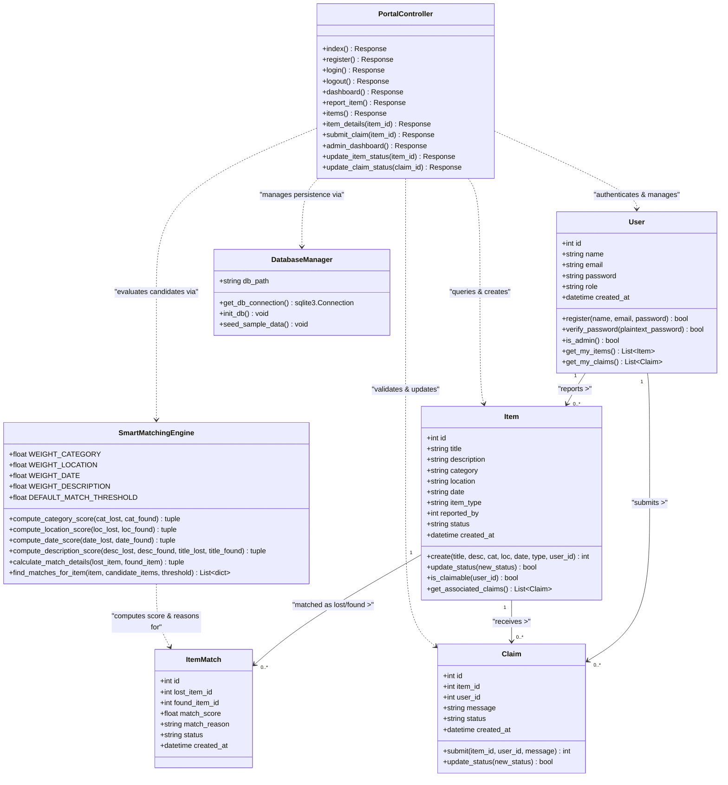

# Class Diagram
## Smart Lost & Found Portal for Campus

This class diagram represents the domain models, database persistence entities, and controller operations of the implemented application, complete with attributes, operational methods, relationships, and multiplicities.

### Class Specifications & Multiplicities

1. **`User` Entity**:
   - Represents student and administrative actors within the system.
   - Enforces unique email constraints and hashed password verification via Werkzeug.
   - Multiplicity: One `User` can report zero or many (`0..*`) `Item` records and lodge zero or many (`0..*`) `Claim` records.

2. **`Item` Entity**:
   - Represents lost or found physical belongings cataloged on campus.
   - Governed by state enumerations: `Pending`, `Verified`, `Rejected`, and `Returned`.
   - Multiplicity: One `Item` is reported by exactly one (`1`) `User` and can have zero or many (`0..*`) `Claim` submissions.

3. **`Claim` Entity**:
   - Represents an ownership claim submitted by a student.
   - Contains identifying proof message and status enumerations: `Pending`, `Approved`, and `Rejected`.
   - Multiplicity: Associated with exactly one target `Item` and one claimant `User`.

4. **`PortalController` & `DatabaseManager`**:
   - Implements role-based decorators (`@login_required`, `@admin_required`) and parameterized SQL operations with transaction commits.
