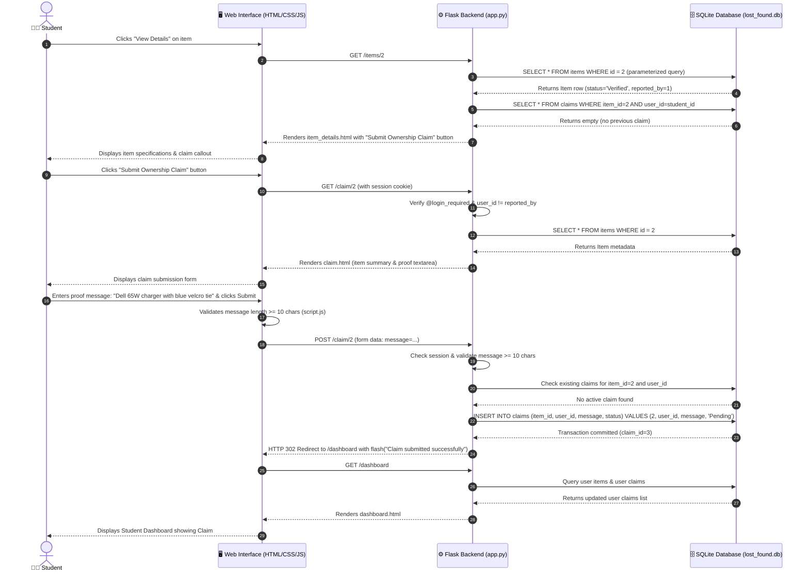

# Sequence Diagram
## Workflow: Student Submits Ownership Claim for a Verified Item

This sequence diagram depicts the detailed end-to-end interactions across actors and architectural layers when a registered student discovers their lost item in the catalog and submits an ownership claim with identifying proof.

### Key Architectural Highlights in Sequence
1. **Security & Session Authentication**: The `@login_required` decorator validates session integrity before exposing the claim submission route.
2. **Business Rule Enforcement**: The backend explicitly verifies that `session['user_id'] != item['reported_by']` and prevents duplicate claims on the same item.
3. **Parameterized SQL Persistence**: The claim message is written safely using parameterized bindings (`?`) preventing SQL injection.
4. **Immediate User Feedback**: The student receives an instant flash confirmation and can track review status directly on their personal dashboard.
