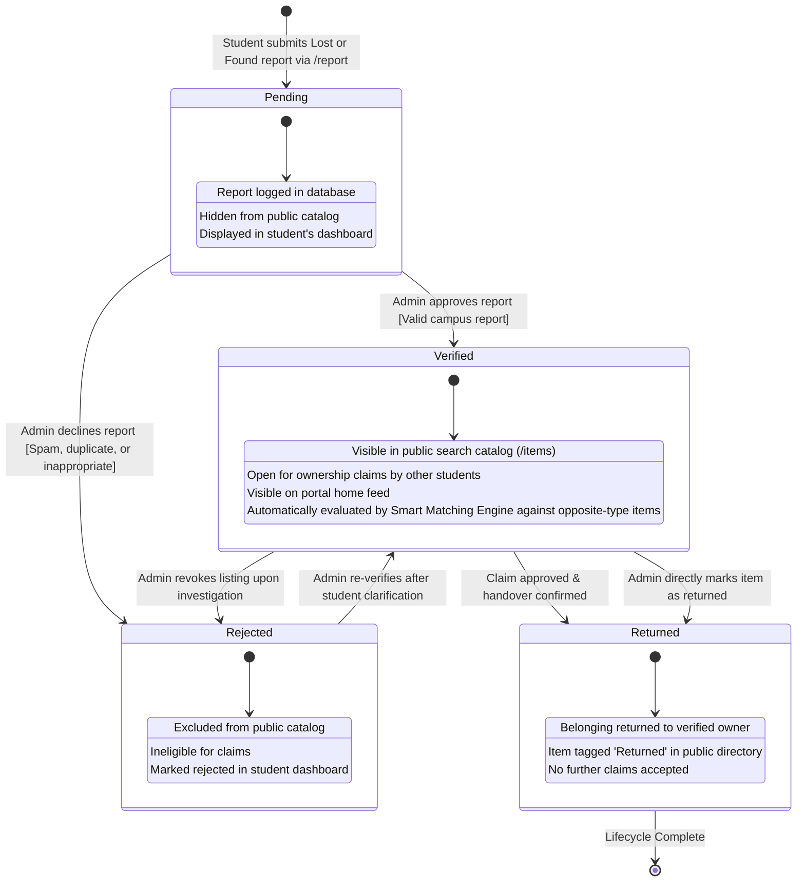

# State Machine Diagram
## Entity Lifecycle: Item Entity

This state machine diagram models the distinct operational states, triggering events, guard conditions, and transitions of the central **Item** entity from initial creation through resolution.

### State Transition Matrix

| Current State | Triggering Event | Guard Condition | Target State | Operational Effect |
|---|---|---|---|---|
| **`[*]` (None)** | Student submits report | Form valid (Title $\ge 3$, Desc $\ge 10$, Date $\le$ Today) | **`Pending`** | Item saved with `status = 'Pending'`; awaits administrative queue review. |
| **`Pending`** | Administrator clicks "Verify" | Report is genuine, appropriate, and relevant | **`Verified`** | Item is published to `/items` catalog; eligible for ownership claims. |
| **`Pending`** | Administrator clicks "Reject" | Report is duplicate, spam, or fails campus criteria | **`Rejected`** | Report disabled; student sees rejection notice in dashboard. |
| **`Verified`** | Administrator approves claim | Ownership proof confirmed & handover authorized | **`Returned`** | Target item marked `Returned`; claim marked `Approved`. |
| **`Verified`** | Administrator clicks "Mark Returned" | Physical owner claimed item in-person at campus desk | **`Returned`** | Item status updated to `Returned`; public notified of successful return. |
| **`Verified`** | Administrator clicks "Reject" | Report flagged as inaccurate post-publication | **`Rejected`** | Item removed from active public claims pool. |
| **`Rejected`** | Administrator clicks "Re-verify" | Reporter provides missing clarification | **`Verified`** | Item restored to active catalog. |
| **`Returned`** | Lifecycle termination | Handover complete | **`[*]`** | Final state; item preserved for campus audit metrics. |
