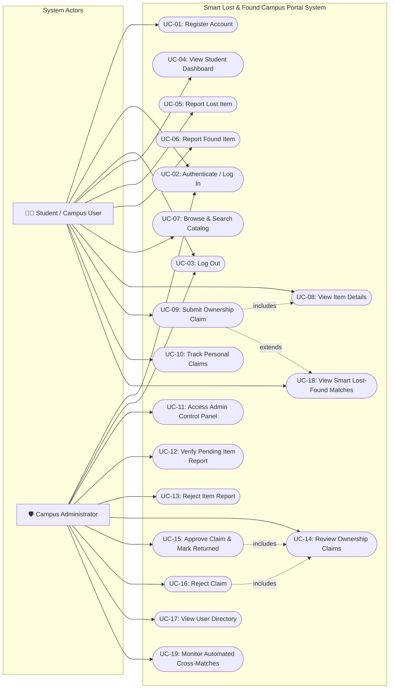

# Use Case Diagram
## Smart Lost & Found Portal for Campus

This diagram represents the functional interactions between the two primary actors (**Student / Campus User** and **Campus Administrator**) and the actual implemented use cases within the application.

### Actor Description & Responsibilities

| Actor | Description | Key System Operations |
|---|---|---|
| **Student / Campus User** | Enrolled student or university community member | Creates account, logs lost or found items, browses verified listings, views detailed specifications, submits ownership claims with proof, and tracks resolution status in personal dashboard. |
| **Campus Administrator** | Campus security officer, lost & found desk custodian, or system supervisor | Authenticates with administrative role, monitors system metrics, verifies or rejects reported items, evaluates claimant proof descriptions, approves legitimate claims, marks items returned, and reviews registered users. |
